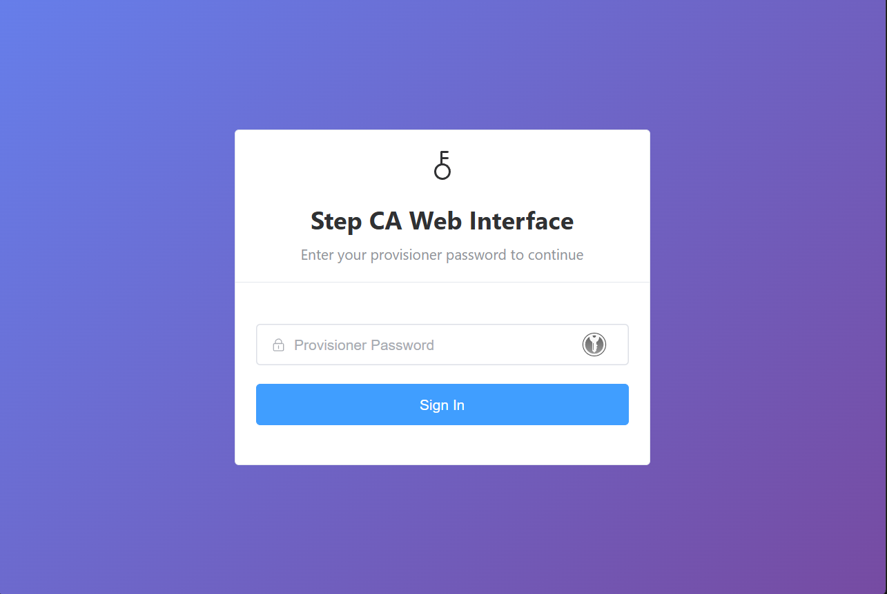
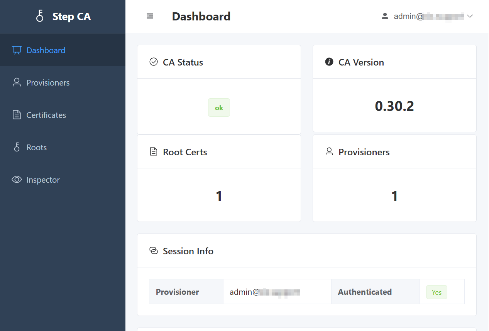
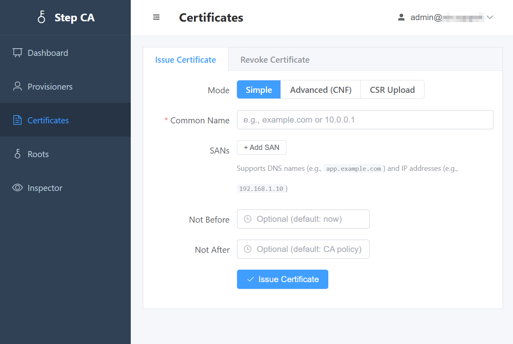
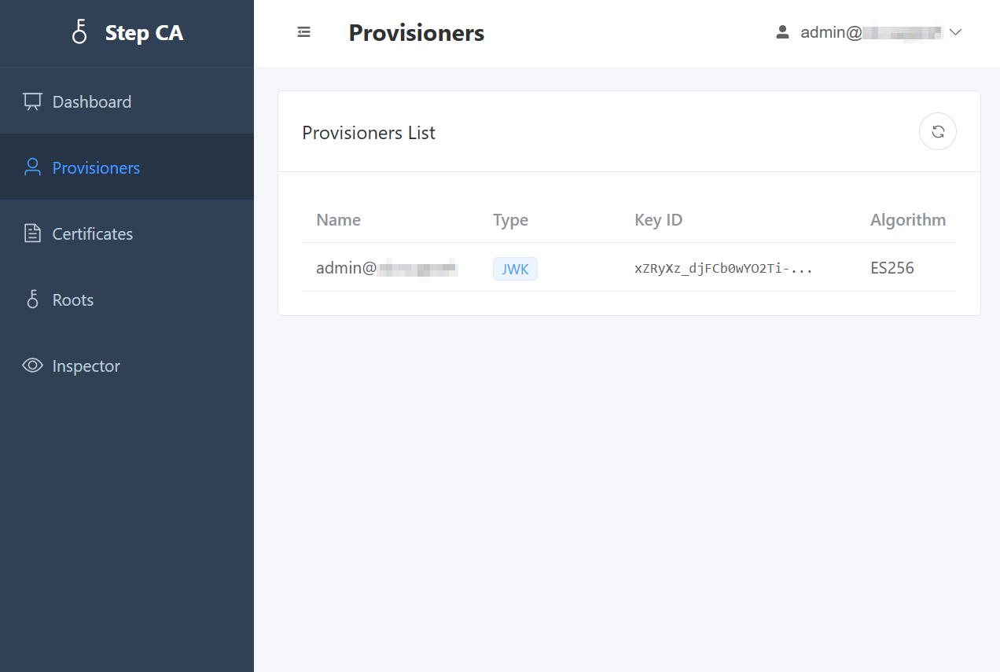
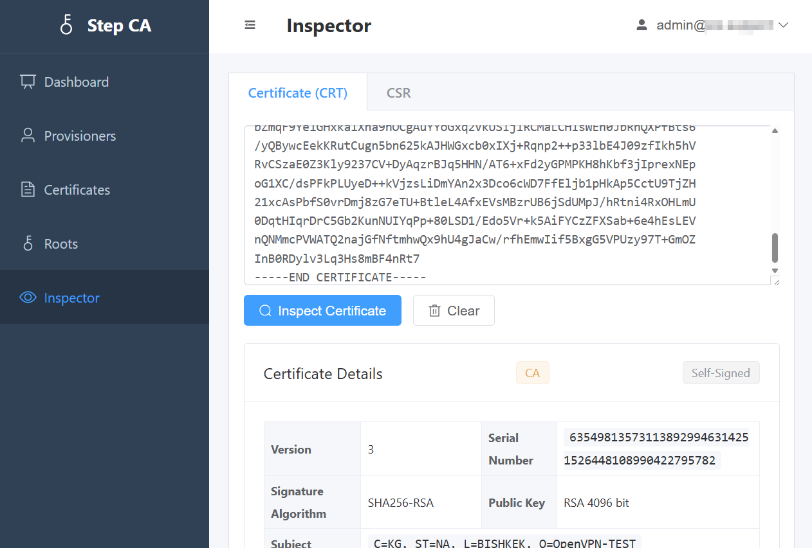
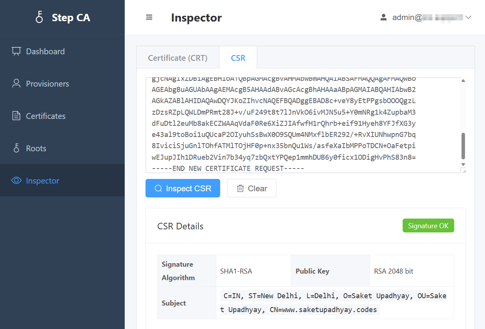

# Step CA Web Interface

A web-based management portal for [smallstep/certificates](https://github.com/smallstep/certificates) (step-ca). Built with **Vue 3 + Element Plus** frontend and **Go** backend, packaged as a single binary with embedded static assets.

## Features

- **Dashboard** — CA health status, version info, and quick statistics
- **Certificate Issuance** — Three modes:
  - **Simple** — enter CN and SANs (DNS names and IP addresses)
  - **Advanced (CNF)** — paste an OpenSSL configuration file; CN, SANs, and subject fields are extracted automatically
  - **CSR Upload** — provide your own PEM-encoded CSR (private key stays on your machine)
- **Certificate Revocation** — revoke certificates by serial number with reason codes
- **Inspector** — inspect Certificate (CRT) and CSR files with detailed field display (equivalent to `openssl x509 -text` / `openssl req -text`)
- **Provisioners** — view configured CA provisioners
- **Roots** — view and download CA root certificates
- **Authentication** — password-only login using the CA provisioner access key (no username required)
- **HTTPS** — optional TLS support with auto-generated self-signed certificates

## Screenshots

**Login**



**Dashboard**



**Issue Certificate (Simple)**



**Provisioners**



**Inspector — Certificate**



**Inspector — CSR**



## Project Structure

```
├── main.go                          # Entry point, HTTP/HTTPS server startup
├── go.mod / go.sum                  # Go module dependencies
├── Dockerfile                       # Multi-stage build (Node.js + Go)
├── .dockerignore
├── internal/
│   ├── auth/middleware.go            # Authentication middleware
│   ├── ca/
│   │   ├── client.go                # step-ca HTTP API client
│   │   └── token.go                 # JWK decryption & OTT token generation
│   ├── cnf/cnf.go                   # OpenSSL CNF file parser
│   ├── config/config.go             # CLI flags & environment variables
│   ├── csr/csr.go                   # Server-side CSR generation
│   ├── server/
│   │   ├── server.go                # Route setup
│   │   ├── handlers_api.go          # API handlers (sign, revoke, parse, etc.)
│   │   ├── handlers_auth.go         # Login/logout/auth-check handlers
│   │   └── handlers_static.go       # Embedded frontend static file serving
│   └── session/session.go           # Encrypted cookie session management
└── web/
    ├── embed.go                     # Go embed.FS for frontend assets
    ├── package.json                 # Node.js dependencies
    ├── vite.config.ts               # Vite build configuration
    ├── index.html
    └── src/
        ├── main.ts                  # Vue app entry point
        ├── App.vue                  # Root component
        ├── api/client.ts            # Axios HTTP client with API methods
        ├── router/index.ts          # Vue Router with auth guards
        ├── stores/                  # Pinia state management
        │   ├── auth.ts
        │   └── ca.ts
        ├── types/index.ts           # TypeScript interfaces
        ├── components/
        │   ├── AppLayout.vue        # Sidebar + header layout
        │   ├── CertDisplay.vue      # PEM certificate display component
        │   ├── IssueCertForm.vue    # Certificate issuance form (Simple/Advanced/CSR)
        │   └── RevokeCertForm.vue   # Certificate revocation form
        └── views/
            ├── LoginView.vue        # Login page
            ├── DashboardView.vue    # Dashboard with CA info
            ├── CertificatesView.vue # Issue / Revoke tabs
            ├── InspectorView.vue    # CRT & CSR inspector
            ├── ProvisionersView.vue # Provisioner list
            └── RootsView.vue        # Root certificates
```

## Tech Stack

| Layer      | Technology                              |
|------------|-----------------------------------------|
| Frontend   | Vue 3, TypeScript, Element Plus, Pinia  |
| Build      | Vite, vue-tsc                           |
| Backend    | Go 1.24, standard library               |
| Auth       | go-jose/v4 (JWK/JWT), gorilla/securecookie |
| Container  | Docker multi-stage (Node 20 + Go 1.24 Alpine) |

## Quick Start

### Prerequisites

- A running [step-ca](https://smallstep.com/docs/step-ca/) instance
- Go 1.21+ and Node.js 20+ (for development)

### Build from Source

```bash
# 1. Build the frontend
cd web
npm ci
npm run build
cd ..

# 2. Build the Go binary
go build -o step-ca-web .
```

### Run

```bash
# HTTP mode (default)
./step-ca-web --ca-url https://your-ca:443 --listen :8080

# HTTPS mode with self-signed certificate (auto-generated)
./step-ca-web --ca-url https://your-ca:443 --https-listen :8443

# HTTPS mode with your own TLS certificate
./step-ca-web --ca-url https://your-ca:443 \
  --https-listen :8443 \
  --tls-cert /path/to/tls.crt \
  --tls-key /path/to/tls.key

# Both HTTP and HTTPS simultaneously
./step-ca-web --ca-url https://your-ca:443 \
  --listen :8080 \
  --https-listen :8443
```

Open `http://localhost:8080` in your browser and log in with your provisioner password.

## CLI Flags

| Flag              | Env Var               | Default  | Description                                      |
|-------------------|-----------------------|----------|--------------------------------------------------|
| `--listen`        | `STEP_WEB_LISTEN`     | `:8080`  | HTTP listen address                              |
| `--https-listen`  | `STEP_WEB_HTTPS_LISTEN` |        | HTTPS listen address (optional)                  |
| `--tls-cert`      | `STEP_TLS_CERT`       |          | TLS certificate PEM file path                    |
| `--tls-key`       | `STEP_TLS_KEY`        |          | TLS private key PEM file path                    |
| `--ca-url`        | `STEP_CA_URL`         |          | Upstream step-ca URL (**required**)              |
| `--tls-skip-verify` |                     | `true`   | Skip TLS verification for upstream CA            |
| `--session-secret`| `STEP_SESSION_SECRET` |          | Session encryption secret (auto-generated if empty) |
| `--session-max-age` |                     | `3600`   | Session lifetime in seconds                      |

## Docker

### Build

```bash
# Default (current platform)
docker build -t step-ca-web .

# Specific platform (requires buildx)
docker buildx build --platform linux/arm64 -t step-ca-web .
docker buildx build --platform linux/amd64 -t step-ca-web .

# Multi-platform image
docker buildx build --platform linux/amd64,linux/arm64 -t step-ca-web .
```

Supported platforms:
- `linux/amd64` (default)
- `linux/arm64`

### Run

```bash
docker run -p 8080:8080 step-ca-web --ca-url https://your-ca:443

# With HTTPS and mounted certificates
docker run -p 8443:8443 -v ./certs:/certs step-ca-web \
  --ca-url https://your-ca:443 \
  --https-listen :8443 \
  --tls-cert /certs/tls.crt \
  --tls-key /certs/tls.key
```

## API Endpoints

### Auth (no authentication required)
| Method | Path             | Description              |
|--------|------------------|--------------------------|
| POST   | `/auth/login`    | Login with provisioner password |
| POST   | `/auth/logout`   | Logout (clear session)   |
| GET    | `/auth/check`    | Check authentication status |

### CA API (authentication required)
| Method | Path                | Description                          |
|--------|---------------------|--------------------------------------|
| GET    | `/api/health`       | CA health check (proxied)            |
| GET    | `/api/version`      | CA version info                      |
| GET    | `/api/roots`        | Root certificates                    |
| GET    | `/api/intermediates`| Intermediate certificates            |
| GET    | `/api/provisioners` | List provisioners                    |
| POST   | `/api/sign`         | Sign a certificate (Simple/CSR mode) |
| POST   | `/api/sign-cnf`     | Sign a certificate from OpenSSL CNF  |
| POST   | `/api/revoke`       | Revoke a certificate                 |
| POST   | `/api/parse-cert`   | Parse/inspect a certificate (PEM)    |
| POST   | `/api/parse-csr`    | Parse/inspect a CSR (PEM)            |
| POST   | `/api/parse-cnf`    | Parse an OpenSSL CNF file            |
| GET    | `/api/crl`          | Download CRL                         |

## Development

```bash
# Terminal 1: Start Go backend
go run . --ca-url https://your-ca:443 --listen :8080

# Terminal 2: Start Vite dev server with API proxy
cd web
npm run dev
```

The Vite dev server runs on `http://localhost:5173` and proxies `/api/*` and `/auth/*` to the Go backend.

## Issued certificate inventory (systemd)

The **Issued Certificates** page shows the latest unexpired certificate per SAN set by default and excludes revocations recorded in the CA journal. Enable **Show history** for previous versions and recorded revocations, and **Show expired** for certificates past their validity period. The read-only API requires a signed-in session. The collector imports the retained `step-ca.service` journal and saves entries by serial as the journal advances. ACME certificates appear when the client retrieves them.

For a systemd installation:

1. Create the system group `step-ca-web-inventory`.
2. Install `deploy/collect-inventory.py` under `/usr/local/lib/step-ca-web/`.
3. Install `deploy/step-ca-web-inventory.service` and `deploy/step-ca-web-inventory.timer` under `/etc/systemd/system/`.
4. Install `deploy/inventory.conf` under `/etc/systemd/system/step-ca-web.service.d/`.
5. Run `systemctl daemon-reload`, `systemctl start step-ca-web-inventory.service`, `systemctl enable --now step-ca-web-inventory.timer`, and restart the web service.

`STEP_WEB_INVENTORY_FILE` selects the inventory file read by the web service.

## License

MIT
